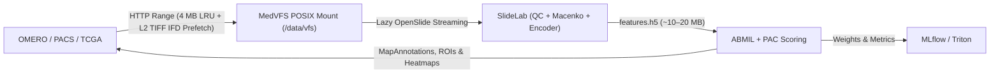

# SlideLab and Polarized Attentional Certainty: A Modular Framework for Zero-Disk Whole Slide Image Preprocessing and Interpretable Multi-Instance Learning

**Lorenzo Olmo Marchal**¹\*, **David Olmo Marchal**¹, and **Jose Maria Olmo Millan**¹  

¹ ColabBio Project (`https://colabbio.org`)  
\* Correspondence: `lolmomarchal@colabbio.org` (`dolmomar@colabbio.org`, `jmolmo@colabbio.org`)  

*Based on the M.S. Thesis Defense in Bioengineering at the University of California, San Diego (UC San Diego, September 22, 2025; Committee: Prof. Ludmil B. Alexandrov [Chair], Prof. Benjamin Smarr, Prof. Vineet Bafna).*

**bioRxiv Category:** Bioinformatics / Computational Pathology  

---

## Abstract

**Motivation:** Computational pathology relies on gigapixel Whole Slide Images (WSIs) that frequently exceed $100{,}000 \times 100{,}000$ pixels. However, widespread adoption in research and clinical settings is hindered by two bottlenecks: (1) unstandardized, I/O-heavy preprocessing pipelines that lack modular quality control (QC) and force terabyte-scale tile duplication, and (2) the "black box" nature of Attention-Based Multiple Instance Learning (ABMIL) models, where scalar attention weights indicate *importance* without revealing *class polarity* or *prediction certainty*.

**Results:** We present **SlideLab**, an open-source, modular WSI preprocessing and streaming framework, paired with **Polarized Attentional Certainty (PAC)**, a $[-1, 1]$ interpretability metric combining per-instance attention magnitude with class-logit certainty. On a benchmark of **1,000 TCGA-COAD WSIs** (20×, 256 px tiles), SlideLab's producer–consumer preprocessing pipeline achieved the highest tissue segmentation Dice score (**0.741 mean / 0.815 median**, Wilcoxon $p = 1.39 \times 10^{-6}$ vs. STAMP; $p < 10^{-5}$ vs. all others) and **88.25% artifact-free tissue tiles**, while outperforming CLAM (7.7× CPU, 6.1× user time) and SlideFlow (2.2× CPU, 1.65× user time) in full QC + Macenko stain normalization. When holding a downstream ABMIL classifier constant for Microsatellite Instability (MSI vs. MSS) prediction, SlideLab achieved top performance on both **FFPE** ($\text{AUC} = 0.761 \pm 0.108$, $\text{F1} = 0.497 \pm 0.136$) and **Flash-Frozen** cohorts ($\text{AUC} = 0.710 \pm 0.008$, $\text{F1} = 0.460 \pm 0.030$). Integrated with **MedVFS** (`cb-vfs`) and **Nextflow** (`cb-slidelab-abmil`), SlideLab enables zero-disk on-the-fly WSI streaming and OMERO write-back. Finally, **PAC** recovers biologically coherent MSI-H immune-hot vs. MSS stromal phenotypes in colorectal cancer WSIs and cleanly separates $\text{CD10}^+/\text{CD34}^+$ B-ALL blasts from $\text{CD45}^+$ T/NK lymphocytes in single-cell flow cytometry ($\text{AUC} = 1.0$).

**Availability:** Source code is available under the Apache 2.0 License at `https://github.com/colabbio/SlideLab`, `https://github.com/colabbio/cb-slidelab-abmil`, and `https://github.com/colabbio/cb-vfs`.

---

## 1. Introduction

Computational pathology enables quantitative, large-scale discovery of morphological biomarkers from digitized hematoxylin and eosin (H&E) Whole Slide Images (WSIs). Unlike traditional visual inspection—which can be subjective and lacks scalability—deep learning pipelines extract subtle spatial patterns predictive of genomic alterations, treatment response, and clinical outcomes.

Despite rapid progress in foundation models and Multiple Instance Learning (MIL), two structural challenges persist:

1. **Unstandardized and Inefficient Preprocessing:** Most studies rely on custom, unshared scripts. Existing end-to-end toolkits (e.g., CLAM, STAMP, SlideFlow, TiaToolBox, PathML) couple tiling, quality control, stain normalization, and feature extraction to rigid workflows, often failing to scale beyond 100–300 WSIs due to memory/time constraints or generating tens of thousands of intermediate PNG/JPEG files per slide.
2. **The "Black Box" Problem in Weakly-Supervised MIL:** In MIL, an entire WSI receives a single slide-level label, and the model must infer which patches (instances) drive the prediction. Post-hoc methods such as SHAP or LIME do not adapt naturally to variable-size bags of thousands of tiles. Standard attention heatmaps highlight *where* the model looks, but attention alone does not indicate whether an instance supports the positive or negative class, nor how certain the model is.

To address both gaps, we introduce **SlideLab** (Aim 1) and **Polarized Attentional Certainty (PAC)** (Aim 2), integrated into the open-source **ColabBio** (`colabbio.org`) federated oncology infrastructure.

---

## 2. Methods

### 2.1 SlideLab Modular Preprocessing Architecture

SlideLab (`SlideLab/SlidePreprocessing.py`) decouples WSI processing into composable, resumable stages with per-slide summary statistics and error reporting:

- **Slide-Level Tissue Segmentation (`TissueMask`):** Adapts the H&E Otsu thresholding formulation of Schreiber et al. (2023) to separate foreground tissue from background glass prior to patching.
- **Producer–Consumer Tile Processing (`SlidePreprocessing`):** Decouples coordinate indexing (`Index Queue`) from parallel tile extraction, quality control, stain normalization, and persistence (`Save Queue`) across configurable CPU/GPU workers.
- **Quality Control & Artifact Filtering:** Filters blurry tiles via Laplacian variance (`--blur_threshold`), removes red and blue pen-marker artifacts via RGB channel thresholding (`--red_pen_check`, `--blue_pen_check`), and enforces minimum tissue content (`--tissue_threshold`).
- **Stain Normalization & Feature Encoding:** Supports Macenko stain normalization (`torchstain`) and modular feature extraction (e.g., ResNet50, UNI) to HDF5 (`features.h5`).

### 2.2 Zero-Disk MedVFS Streaming, Nextflow Orchestration, and OMERO Write-Back

Within the ColabBio ecosystem (`cb-slidelab-abmil` + `cb-vfs`), SlideLab eliminates intermediate tile disk writes:

- **Streaming Extraction (`StreamingTileDataset`):** Reads WSI byte ranges lazily through MedVFS POSIX mounts directly into RAM/VRAM without materializing 5,000–20,000 intermediate PNG/JPEG tile files per slide.
- **Database-First OMERO Write-Back:** Rather than leaving disconnected output files, results (classification probabilities, mean PAC scores, QC metrics) are persisted back to OMERO via persistent image IDs as `MapAnnotation` key-value pairs, `ROI` overlays, and heatmap file attachments, supporting passwordless ephemeral `OMERO_SESSION` minting.

### 2.3 Polarized Attentional Certainty (PAC)

In ABMIL, attention weights $\alpha_i \in [0, 1]$ quantify the relative importance of instance $i$ in aggregating the bag representation, while class logits $z_i$ (or class probability differences) capture predictive direction. **Polarized Attentional Certainty (PAC)** combines both signals into a bounded score $\text{PAC}_i \in [-1, 1]$:

- **$\text{PAC}_i \to +1$:** High attention and high certainty toward the positive class (e.g., MSI-H or B-ALL blast).
- **$\text{PAC}_i \to -1$:** High attention and high certainty toward the negative class (e.g., MSS or non-B-ALL lymphocyte), or low certainty with high attention.

This allows practitioners to rank and inspect the biological extremes (e.g., 1st percentile vs. 99th percentile PAC instances) across both histopathology tiles and single-cell flow cytometry events.

---

## 3. Results

### 3.1 Computational Performance (1,000 TCGA-COAD WSIs)

All pipelines were benchmarked under identical settings (20× magnification, 256 px tiles) up to 1,000 WSIs from TCGA-COAD. TiaToolBox and PathML failed beyond 100–300 WSIs due to memory/time constraints.

- **Baseline Tiling (1,000 WSIs):** SlideLab completed in **177.54 min user time** (1.37× faster user time than STAMP, which only extracted coordinates). Compared to other tools, CLAM was **40.6× slower** in CPU time (**17.5× slower** in user time) and SlideFlow was **11.6× slower** in CPU time (**4.7× slower** in user time).
- **Full Pipeline (Tiling + QC + Macenko Stain Normalization, 1,000 WSIs):**
  - **7.7× faster** in CPU time and **6.1× faster** in user time than **CLAM**.
  - **2.2× faster** in CPU time and **1.65× faster** in user time than **SlideFlow**.
  - Comparable user time to STAMP (1.1×), while performing full QC and stain normalization rather than coordinate extraction alone.

### 3.2 Quality Control & Tissue Segmentation

Evaluated against GrandQC ($\text{Dice} = 0.938$ reference for tissue segmentation):
- **Slide-Level Tissue Segmentation:** SlideLab achieved the highest **mean Dice (0.741)** and **median Dice (0.815)**, significantly outperforming STAMP (Wilcoxon signed-rank $p = 1.39 \times 10^{-6}$) and all other tools ($p < 10^{-5}$).
- **Tile-Level Artifact Rejection:** SlideLab yielded the highest percentage of **artifact-free tissue tiles (88.25%)** and the lowest artifact contamination across categories (except air bubbles).

### 3.3 Downstream ABMIL Classification (MSI vs. MSS in Colorectal Cancer)

Holding the ABMIL model architecture constant across all preprocessing tools (10-fold cross-validation on an internal cohort, evaluated on an unseen TCGA-COAD test set):

| Cohort | Preprocessing Pipeline | AUC | F1 Score | Notes |
|---|---|---|---|---|
| **FFPE** | **SlideLab (Full: QC + Stain Norm)** | **$0.761 \pm 0.108$** | **$0.497 \pm 0.136$** | Highest recall ($p < 0.01$ vs. all others) |
| **FFPE** | **SlideLab (QC Only)** | $0.733 \pm 0.023$ | $0.482 \pm 0.054$ | Lowest variance; F1 $> $ SlideFlow ($p=0.002$), STAMP ($p=0.0039$) |
| **FFPE** | SlideFlow | $0.721$ | $0.386$ | Lower F1 vs. SlideLab Full ($p=0.0273$) |
| **FFPE** | STAMP | $0.714$ | $0.327$ | Lower AUC ($p=0.0469$) & F1 ($p=0.0039$) vs. SlideLab QC |
| **FFPE** | CLAM | $0.644$ | $0.294$ | Lowest across all metrics |
| **Flash-Frozen** | **SlideLab (Full: QC + Stain Norm)** | **$0.710 \pm 0.008$** | **$0.460 \pm 0.030$** | Statistically superior to CLAM, SlideFlow, STAMP ($p < 0.05$) |
| **Flash-Frozen** | **SlideLab (QC Only)** | $0.688 \pm 0.016$ | $0.281 \pm 0.073$ | Significant AUC vs. all other tools ($p < 0.006$) |
| **Flash-Frozen** | SlideFlow | $0.660$ | $0.336$ | Lower AUC vs. SlideLab QC ($p=0.0059$) |

### 3.4 Interpretability Case Study 1: Colorectal Cancer MSI-H vs. MSS (WSI)

Applying PAC to the TCGA-COAD ABMIL classifier and segmenting tissues (U-Net) and nuclei (HoVer-Net trained on PanNuke and MoNuSAC) revealed clear biological separation between the **99th percentile PAC** (MSI-H) and **1st percentile PAC** (MSS) patches:

- **Tissue Composition:** 99th percentile PAC patches were enriched in **inflammatory (3.09% vs. 0.79%; 9,868 vs. 237 $\text{px}^2$)** and **necrotic (24.56% vs. 4.46%; 178,733 vs. 23,273 $\text{px}^2$)** regions, whereas 1st percentile PAC patches were dominated by **stroma (60.71% vs. 18.27%; 670,684 vs. 133,339 $\text{px}^2$)**.
- **Nuclei Classification & Morphology:** 99th percentile PAC patches showed higher **lymphocyte** infiltration (PanNuke: **41.66% vs. 23.61%**) and **inflammatory** nuclei (MoNuSAC: **17.18% vs. 6.01%**), with smaller, rounder, more compact nuclei (median area $288.0$ vs. $319.0\text{ px}^2$; circularity $0.831$ vs. $0.772$). Conversely, 1st percentile PAC patches exhibited more **epithelial/connective** nuclei (connective: **48.99% vs. 27.18%**) with larger, elongated, asymmetric morphology.

### 3.5 Interpretability Case Study 2: B-Cell Acute Lymphoblastic Leukemia (Flow Cytometry)

In single-cell flow cytometry for B-ALL diagnosis (model $\text{AUC} = 1.0$, fold #4), probability-based and attention-based top percentiles failed to cleanly isolate the clinical blast immunophenotype (returning overly high FSC/SSC or ambiguous marker profiles). **PAC-based selection** achieved clean biological separation:
- **99th percentile PAC:** Classical **B-ALL blasts** ($\text{CD10}^+$, $\text{CD34}^+$, $\text{CD19}^+$, $\text{CD24}^+$, $\text{CD22}^+$, low-to-moderate FSC/SSC).
- **1st percentile PAC:** **Non-B-ALL mature T/NK lymphocytes** ($\text{CD45}^+$, low CD19/CD10/CD34).

---

## 4. Discussion and Conclusion

Clean, standardized preprocessing exerts a larger impact on downstream computational pathology performance than raw tile quantity or model complexity alone. **SlideLab** provides a fast, reproducible, and Apache 2.0-licensed foundation that scales to 1,000+ WSIs and integrates seamlessly with **MedVFS** and **Nextflow** for zero-disk hospital-edge execution. **PAC** complements this pipeline by translating weakly-supervised MIL decisions into biologically verifiable tissue, nuclear, and single-cell phenotypes. Future work will extend PAC to multi-class formulations, prognostic survival endpoints, and human-in-the-loop pathologist refinement.

---

## References

1. Schreiber BA, et al. Bang and the artefacts are gone! Rapid artefact removal and tissue segmentation in haematoxylin and eosin stained biopsies. *arXiv:2308.13304*. 2023.
2. Macenko M, et al. A method for normalizing histology slides for quantitative analysis. *Proc IEEE ISBI*. 2009:1107–1110.
3. Ilse M, Tomczak J, Welling M. Attention-based Deep Multiple Instance Learning. *Proc ICML*. 2018;80:2127–2136.
4. Chen RJ, et al. Towards a general-purpose foundation model for computational pathology. *Nat Med*. 2024.
5. Graham S, et al. Hover-Net: Simultaneous segmentation and classification of nuclei in multi-tissue histology images. *Med Image Anal*. 2019;58:101563.
